# Triển khai training YOLO11n cho release auto V2

Ngày bắt đầu: 13/11/2026 (UTC+7). Phạm vi: code, preflight, smoke GPU, thử resume GPU, baseline, validation, đóng gói. Final test luôn khóa. Máy local vừa kiểm tra: Python 3.11.16, torch 2.5.1+cpu, CUDA=False, Ultralytics 8.4.178. Chưa có runtime Colab được kết nối trong các bề mặt browser hiện có; không train CPU thay GPU.

## Nguồn và trách nhiệm của từng quyết định

| Nguồn | Nội dung dùng | Áp dụng trong công việc này |
|---|---|---|
| Người dùng, `prompts/training_yolo11n.md` | Skeleton trước, triển khai tiếp; release 9042/3909/29; checkpoint từng epoch; macro F1 supported; GPU bắt buộc; không final test | Yêu cầu chính, ưu tiên hơn mặc định prototype |
| Nhận xét GVHD trong DOCX, đoạn đỏ C00000 số 83–84, 94, 299, 480 (chỉ số đoạn XML từ 0) | Chống trùng/rò rỉ, người mới, cùng test/lớp hoặc tách kết quả; M/N, Coverage và Accuracy, Wilson và giới hạn | Kiểm tra leakage, phân tích validation và diễn giải thận trọng. 3 seed/ablation/McNemar ở đoạn 299 trực tiếp nhắm ST-Hybrid/MLP; chưa chặn baseline YOLO |
| Nội dung báo cáo cũ trong cùng DOCX | Các kết quả 99%, test 53 ảnh, các mô hình/dataset cũ | Chỉ là lịch sử; không điền vào kết quả run mới. DOCX không có comments.xml; góp ý được nhúng trong thân bài, phân biệt bằng văn bản/màu |
| `reports/asl_alphabet_rerun_20261102/PLAN.md` | RGB detector, adapter, validation macro F1, không dùng split prototype | Kế thừa nguyên tắc; số 28 lớp và split cũ được thay bằng release auto V2 theo yêu cầu mới |
| `reports/asl_yolo11n_group_532_auto_v2/{AUTO_REVIEW_REPORT.md,IMPORTANT_STEPS.md,VALIDATION.json}` | QC tự động được phép, giữ gallery/pending/holdout; 22 positive nothing train, 0 val | Không mở lại QC; chỉ kiểm tra tính toàn vẹn |
| `data/processed/asl_yolo11n_group_532_auto_v2/{release.json,validation.json,training_plan.json,review_policy.json,source_manifest_reference.json,augmentation_baseline.yaml}` | Danh sách ảnh/box/hash, mapping, fingerprint, nguồn/policy, augmentation khóa | Adapter đọc trực tiếp schema release, không sửa metadata đóng băng |
| Nhóm trưởng `project_sources/staticsl_latest/src/training/train_optimized.py`, `src/evaluation/evaluate.py`, `src/utils/visualization.py` | TensorFlow ST-Hybrid: best checkpoint, validation/history, loss/Accuracy, confusion, F1, ví dụ, ảnh 300 dpi | Tham khảo tổ chức. Không lấy optimizer/augmentation landmark/kiến trúc; không sao chép nhánh fallback random hoặc số gán sẵn |
| `reports/staticsl_github_review_20261113.md` | YOLO metrics notebook gán cố định; split validation khác nhau | Không nhập metrics cũ hoặc xếp hạng ba mô hình |
| `src/asl_yolo/{training,evaluation,review532,autoreview532}.py` | Mapping, JSON/hash, định nghĩa negative, kiểm tra leakage và release | Tái dùng helper thuần còn đúng; không sửa API cũ; `protocol.resolve_image_prediction` cũ đổi rejection thành nothing nên không dùng cho metrics mới |
| Notebook 00/01/02, `scripts/{package_colab,build_notebook,build_colab_launcher,run_colab_pipeline}.py`, `DRIVE_SETUP.md`, `COLAB_START.md` | Luồng mount/cache/source, cách đóng gói và lịch sử prototype | Notebook 03 độc lập; không nối vào test tự động của prototype |
| Đề xuất kỹ thuật của Codex | Gói chỉ ảnh train/val và bằng chứng leakage đã khóa; journal epoch immutable có checksum; trainer/validator adapter pin 8.4.178; single GPU/workers=0 | Đây là lựa chọn triển khai bổ sung, không phải yêu cầu cô hay phê duyệt nhóm trưởng |

## Luồng và thư mục

```mermaid
flowchart LR
  R[Release auto V2 bất biến] --> P[Preflight hash mapping labels leakage CUDA storage]
  P --> D[Adapter tạo danh sách train val và YAML riêng]
  D --> S[Smoke 3 epoch subset cố định]
  S --> X[Thử dừng và resume tiến trình mới]
  X --> B[Baseline từ pretrained COCO mới tối đa 50 epoch]
  B --> E[Validator detection và image metrics mỗi epoch]
  E --> C[Commit epoch checkpoint history predictions checksum]
  C --> F[Khóa best macro F1]
  F --> V[Sweep confidence chỉ validation]
  V --> A[Figures CSV JSON gallery REPORT bundle]
```

`src/asl_yolo/train_release/`: config (cổng/cấu hình), dataset (schema/hash/leakage/loader), metrics (thuần toán), storage (lock/journal/checkpoint), engine (adapter Ultralytics), runner (new/resume/OOM), reporting (validation/figures/gallery), cli (lệnh). `scripts/train_release.py` chỉ gọi CLI. `scripts/package_training_release.py` đóng gói và `scripts/build_training_notebook.py` tạo notebook 03. Cấu hình mới ở `configs/asl_yolo11n_auto_v2_training.json`. Kết quả từng run nằm `runs/<run_id>/`; tài liệu và kiểm tra trong thư mục báo cáo này.

## Protocol khóa trước khi có kết quả

- Train 9042/val 3909; classes A..Z, del, nothing, space. Fingerprint `fbb9d072079f9a08d42e953d5927b232f64497f0d4d3d3e8e9309e045772efdf`; asset SHA `0ebbc80d4a7680d14987a577cd21342b65ecfd94632bd9a8da63ae6417644ee1`.
- imgsz=320, batch=8, freeze=0, seed=42, AMP=False; toàn augmentation baseline YAML. Chọn SGD lr0=.01, momentum=.937, weight_decay=.0005, scheduler linear lrf=.01, warmup=3 epoch; đây là cấu hình Codex công bố trước run, không phải sao chép ST-Hybrid. Lưu toàn bộ mặc định sau resolve. Patience=0 (tắt early stopping), không chọn bằng native fitness.
- Full val mỗi epoch, conf monitoring=.25, NMS IoU=.7, class-aware, multi_label=True như detection validator 8.4.178, max_det=300; giữ cùng postprocess trong analysis/inference. Dự đoán sau NMS có confidence cao nhất, tie giữ thứ tự validator. Không có box là NO_DETECTION, luôn ở mẫu số positive; background tách riêng.
- Freeze 28 tên lớp positive val ở preflight; metric chính `val_macro_f1_supported`, tie Accuracy rồi epoch sớm hơn. Macro P/R/F1 không thêm NO_DETECTION, không thêm lớp nothing support=0. F1/recall nothing=N/A, FP vẫn lưu. Weighted F1 theo support. Bảo toàn native best.pt, lưu riêng best_macro_f1.pt.
- Checkpoint dùng EMA float32 cho inference chọn theo metric, resume giữ riêng raw model float32 + EMA float32 + optimizer/scheduler/scaler/RNG và epoch; không hứa bit-for-bit vì loader/framework/hardware. Native last/best có thể bị strip; journal last_resume không bị final_eval sửa.
- Sweep grid .05,.10,...,.95, chọn macro F1 supported, tie Accuracy rồi threshold cao hơn; chỉ sau baseline hoàn tất và khóa SHA checkpoint. Inference giữ class-aware multi-label NMS giống validator. Cả checkpoint và threshold chọn trên val, nên là kết quả phát triển.
- Coverage=accepted positive/all positive; conditional Accuracy=N/A khi accepted=0; overall Accuracy=correct/all positive. Wilson 95% trên positive correct/n; các frame tương quan làm yếu giả định độc lập.
- Phân tích confusion count/row-normalized có cột NO_DETECTION, F1/support, M/N/top pairs, correct/wrong/rejected/background FP/high-confidence wrong overlays. GT box tự động màu xanh, predicted đỏ, ID truy vết. Detection đo mức khớp weak localization labels; J/Z chỉ tư thế tĩnh.
- PNG 300 dpi + SVG, CSV/JSON gốc, captions không đường dẫn nội bộ, phụ lục checksum. Không vẽ train Accuracy giả, không chấm test/external. Benchmark tùy chọn riêng batch1/20 warmup/500 đo, không suy webcam FPS.

## New run, resume và điều kiện dừng

New: preflight dữ liệu, asset, phiên bản, GPU và durable root → run_id mới → config/environment/source hashes → adapter train/val → train/validate → epoch commit → kết thúc hoặc lỗi. Smoke subset deterministic theo class/capture type, 4 train và 2 val mỗi stratum; lưu ID, seed. Baseline luôn từ asset COCO, chỉ sau evidence smoke và resume GPU đạt.

Resume: chỉ run chưa hoàn tất, checkpoint commit chỉ định rõ; kiểm tra checksum/config/mapping/release/phiên bản/code và trạng thái process; acquire lock single writer; phục hồi history tới epoch checkpoint rồi epoch kế tiếp. Không replay epoch đã commit. Dừng có kiểm soát bằng exception sau commit thay vì để final_eval strip. Journal giữ generation trước khi generation mới hoàn chỉnh; phát hiện file `.partial`/commit thiếu và chọn generation hợp lệ rõ ràng. Trên Drive không tuyên bố rename atomic. Sau epoch dang dở có thể chạy lại epoch đó; trước epoch đầu không có checkpoint.

Dừng khi release/count/hash/mapping khác, box/background sai, bằng chứng leakage thiếu/xung đột, asset sai, framework khác, không CUDA, thiếu storage, job cũ còn chạy/không xác định ở host khác, checkpoint/config/code không tương thích, loss/gradient không hữu hạn hoặc artifact không load. OOM giữ attempt/log, batch 8→4→2→1 ở run mới từ pretrained. Không giảm imgsz, đổi ảnh hay tự chạy CPU.

## Kiểm chứng và đầu ra

Unit/integration tests: adapter/mapping/corruption; NO_DETECTION/support=0/background; checkpoint tie; transaction bị ngắt, checksum/lock/history/resume gates; loader và augmentation thực; native final_eval và extra callback. Số liệu giả chỉ fixture test, không báo cáo thực nghiệm. Source inspection và docs chính thức trong verification.

GPU sequence: smoke3 → resume probe tổng4 dừng sau1, process mới resume tới4 → kiểm tra optimizer/history/model/predict → ước tính thời gian/dung lượng từ smoke → baseline50 → analysis val. Không có GPU: hoàn tất code, tests, gói source/data/notebook; tất cả giai đoạn chưa chạy ghi đúng trạng thái. Chưa có thời gian smoke thực nên không bịa ETA baseline. Lưu mọi epoch; dự toán dung lượng bảo thủ 12 GiB/run, kiểm tra lại kích thước checkpoint thật sau smoke, không tự xóa artifact.

Nguồn kỹ thuật: [Train](https://docs.ultralytics.com/modes/train/), [Callbacks](https://docs.ultralytics.com/usage/callbacks/), [Metrics](https://docs.ultralytics.com/guides/yolo-performance-metrics/), kiểm tra ngày 13/11/2026; quyết định adapter dựa trực tiếp source local 8.4.178.
