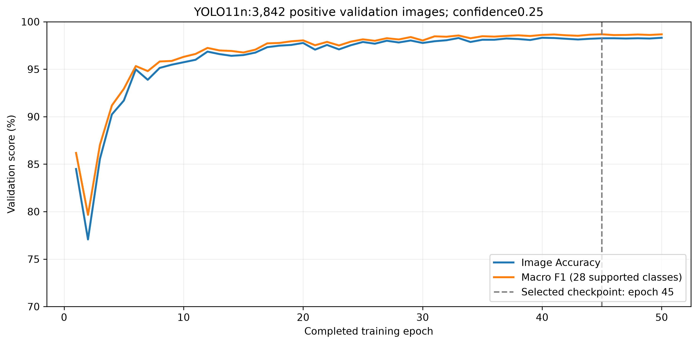
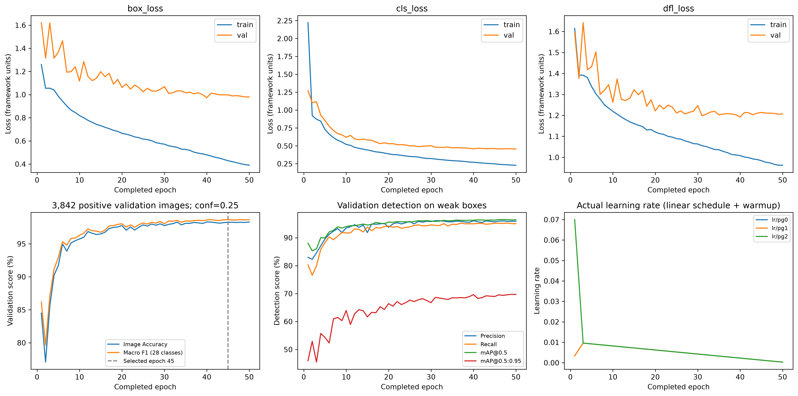
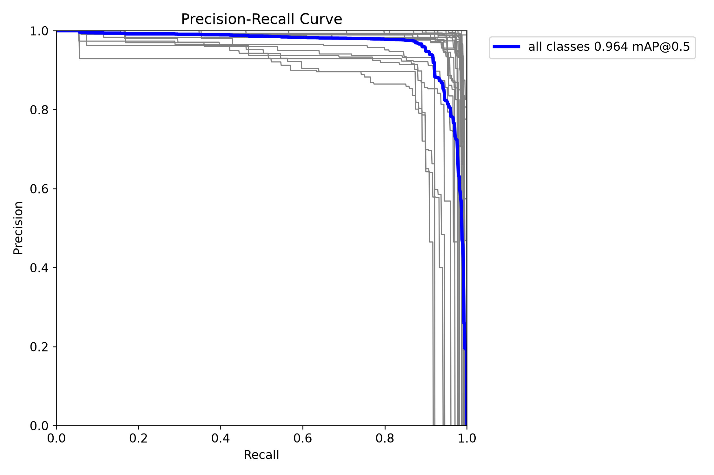
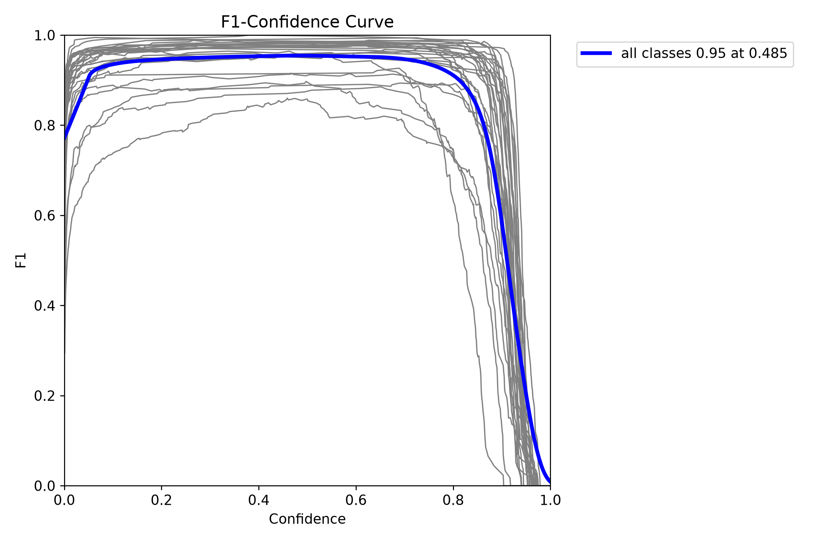
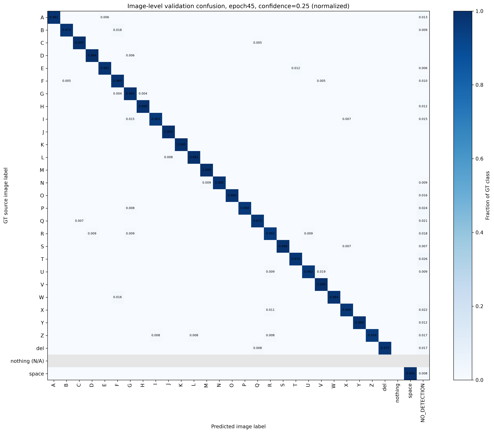
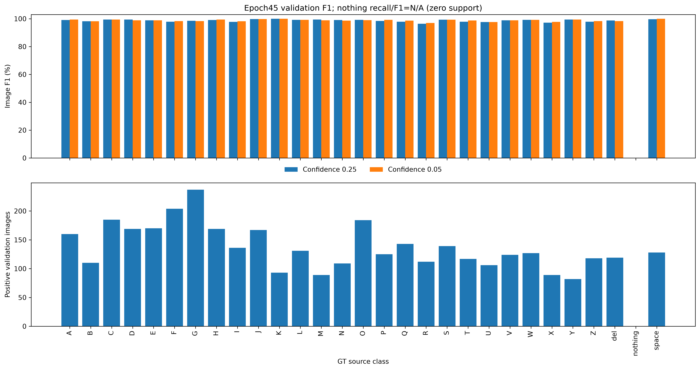
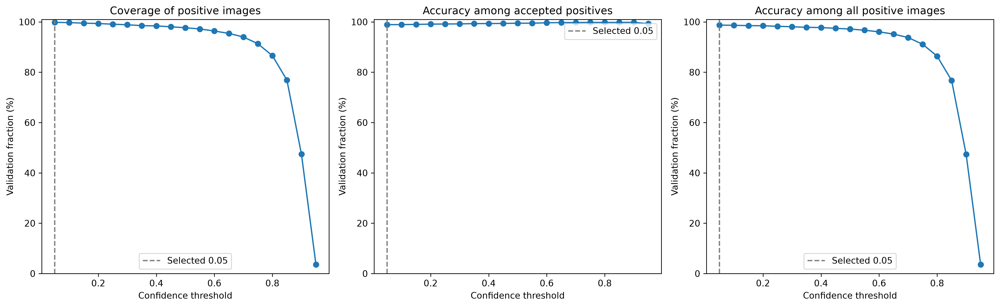

# Baseline YOLO11n ngày 14 tháng 11 năm 2026

Run `20261114T065750Z_baseline_d5cb4953` hoàn tất 50/50 epoch trên Tesla T4, session 7.177,18 giây. Smoke 3 và resume probe tổng 4 epoch hoàn tất trong các run kỹ thuật riêng, không cộng vào 50 epoch baseline.

## Checkpoint được chọn

Chọn **epoch 45** theo Macro F1 mức ảnh tại confidence 0,25 trên 28 lớp có positive validation. Train 9.042 ảnh; validation 3.842 positive + 67 nền. Positive `nothing` support 0 nên Recall/F1 là N/A. `NO_DETECTION` giữ trong mẫu số positive và cột prediction, không là lớp GT mới.

| Metric | Confidence 0,25 | Cùng epoch 45 với confidence 0,05 |
|---|---:|---:|
| Accuracy positive | 98,26% (3.775/3.842) | 98,72% (3.793/3.842) |
| Macro F1 supported 28 | 98,67% | 98,79% |
| Weighted F1 | 98,70% | 98,81% |
| Coverage | 99,09% | 99,82% |
| Accuracy trong số chấp nhận | 99,16% | 98,90% |
| Không detection | 35 | 7 |
| Sai lớp | 32 | 42 |
| False positive trên nền | 0/67 | 0/67 |

Ngưỡng 0,05 tốt nhất trong lưới validation 0,05..0,95 đã khai báo trước, không phải tối ưu toàn cục. Cả model và ngưỡng chọn trên validation nên đây là kết quả phát triển. Wilson 95% Accuracy tại 0,25 là 97,79–98,62%; frame tương quan và chọn model làm việc suy rộng sang người mới không hợp lệ. 0 FP trên 67 nền không chứng minh FPR thực tế bằng 0.

## Hội tụ và detection

Các đường loss giảm và validation gần phẳng cuối run; 50 epoch là baseline hợp lý trên validation này, chưa có bằng chứng cần tăng ngay 100 epoch. Mười epoch cuối Macro F1 khoảng 98,52–98,67%. Độ lệch chuẩn qua epoch không phải độ lệch chuẩn qua các seed độc lập.

Detection ở epoch 45: Precision 95,68%, Recall 95,22%, mAP50 96,30%, mAP50-95 68,97%. Detection đo khớp với weak boxes tự động, khác Accuracy nhãn ảnh.

Native detection best là epoch **49**, khác checkpoint Macro F1 epoch **45**. Hai curve gốc dưới đây thuộc native best: mAP50 khoảng 0,964 và detection F1 khoảng 0,95 tại confidence 0,485; không dùng 0,485 thay ngưỡng image-level 0,05.

## Phân tích lớp và ngưỡng

M thành N có 0 ảnh, N thành M có 1 ảnh tại confidence 0,25; ở 0,05, N thành M tăng lên 2. Các lớp F1 thấp hơn gồm R, X, U. Các cặp lặp hai ảnh gồm E thành T, I thành G, B thành F, W thành F, U thành V. Số liệu gốc trong `metrics/` và `summary.json`.

## Phạm vi kiểm chứng

Đã đối chiếu history 50 epoch/50 commit marker, config/fingerprint/mapping, SHA model được chọn và last resume; replay predictions validation ở 0,25 khớp kết quả gốc. Model load/predict được một ảnh validation thật trên CPU. Resume probe GPU có bằng chứng phục hồi tiến trình mới. Không kiểm byte toàn bộ 50 checkpoint.

Nhãn và box tự động chưa có kiểm định chuyên gia ASL; phần lớn session chưa được xác minh. Chưa có final test/người mới, benchmark hoặc so sánh ba mô hình cùng test. J/Z chỉ tư thế ảnh tĩnh. Không nhập số YOLO gán cố định từ notebook nhóm vào bảng này.
